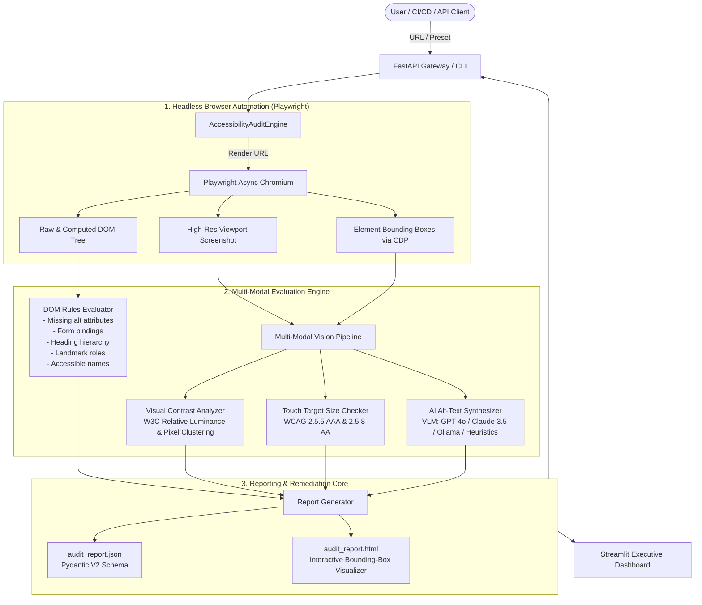

# AI Website Accessibility Auditor

[](https://www.python.org/)
[](https://fastapi.tiangolo.com/)
[](https://playwright.dev/python/)
[](https://www.w3.org/WAI/WCAG21/quickref/)
[](https://ec.europa.eu/social/main.jsp?catId=1202)
[](https://opensource.org/licenses/MIT)

> **Enterprise-grade automated accessibility compliance engine combining headless browser automation (Playwright), programmatic DOM heuristics, and Vision-Language Models (VLM) to audit, score, and remediate web applications against WCAG 2.1 Level AA and European Accessibility Act (EAA Directive 2019/882 / EN 301 549) mandates.**

---

## 🏛️ System Architecture

The AI Website Accessibility Auditor decomposes accessibility compliance into three synchronized pipelines: **Headless Browser Crawler**, **Multi-Modal Vision Engine**, and **Remediation & Reporting Core**.



### ASCII Architectural Overview
```text
+-----------------------------------------------------------------------------------+
|                        AI WEBSITE ACCESSIBILITY AUDITOR                           |
+-----------------------------------------------------------------------------------+
       |
       v
 [ Target URL ] ---> [ Playwright Headless Chromium Engine ]
                            |
        +-------------------+-------------------+
        |                                       |
        v                                       v
 [ Rendered DOM & Tree ]             [ High-Res Screenshots & BBoxes ]
        |                                       |
        +-----> DOM Rules Evaluator             +-----> Visual Contrast Analyzer
        |       - 1.1.1 Non-Text Content        |       - W3C Relative Luminance
        |       - 1.3.1 Info & Relationships    |       - Gradient / Image Patches
        |       - 2.4.2 Page Titled             |
        |       - 2.4.4 Link Purpose            +-----> Touch Target Checker
        |       - 4.1.2 Name, Role, Value       |       - 44x44px (AAA) & 24x24px (AA)
        |                                       |
        +---------------------------------------+-----> Multi-Modal VLM Alt Synthesizer
                                                        - Context-Aware Image Labeling
                                                        |
                                                        v
                                         [ Pydantic V2 Report Generator ]
                                                        |
                                      +-----------------+-----------------+
                                      |                                   |
                                      v                                   v
                             [ audit_report.json ]              [ audit_report.html ]
```

---

## 🔬 Technical Specifications & Benchmarks

| Specification Category | Metric / Standard | Architectural Implementation |
| :--- | :--- | :--- |
| **Accessibility Baseline** | WCAG 2.1 Level AA & EN 301 549 | Programmatic verification across Perceivable, Operable, Understandable, Robust |
| **European Compliance** | Directive 2019/882 (EAA) | Zero-Critical-Barrier enforcement model for commercial digital portals |
| **Browser Driver Engine** | Playwright Chromium (Async) | Non-blocking Chrome DevTools Protocol (CDP) evaluation with JS-evaluated bounding boxes |
| **Static Crawler Fallback** | BeautifulSoup4 + lxml | Zero-crash fallback when bot protection or network air-gaps block headless drivers |
| **Visual Contrast Analysis** | W3C Relative Luminance ($L$) | Pixel clustering: $L = 0.2126 R + 0.7152 G + 0.0722 B$ over image/gradient patches |
| **Touch Target Precision** | Sub-pixel CSS geometry | Evaluates interactive controls against $44 \times 44\text{px}$ (AAA) and $24 \times 24\text{px}$ (AA) |
| **Vision AI Providers** | Multi-Modal Hybrid | OpenAI (`gpt-4o`), Anthropic (`claude-3-5-sonnet`), Ollama (`llava`), and deterministic fallback |
| **API Architecture** | FastAPI + Pydantic V2 | Async REST API endpoints with OpenAPI / Swagger documentation |
| **Executive UI** | Streamlit | Interactive score gauges, radar metrics, bounding box visualizers, and code patches |

---

## 📋 Mapped WCAG 2.1 AA Success Criteria

| WCAG Criterion | Level | Principle | Description & Remediation |
| :--- | :---: | :---: | :--- |
| **1.1.1 Non-text Content** | A | Perceivable | Identifies missing or generic `alt` attributes on images; generates AI alt-text patches |
| **1.3.1 Info & Relationships** | A | Perceivable | Validates form `<label for="id">` associations and detects skipped heading levels ($h_1 \to h_3$) |
| **1.4.3 Contrast (Minimum)** | AA | Perceivable | Computes $\ge 4.5:1$ (normal text) and $\ge 3.0:1$ (large text) over image/gradient backgrounds |
| **2.4.1 Bypass Blocks** | A | Operable | Checks for accessible `<a class="skip-link">` bypass mechanisms |
| **2.4.2 Page Titled** | A | Operable | Detects missing or generic `<title>` tags across document metadata |
| **2.4.4 Link Purpose** | A | Operable | Flags ambiguous anchor phrases ("click here", "read more") lacking destination context |
| **2.5.5 / 2.5.8 Target Size** | AA/AAA | Operable | Validates that buttons and navigation links meet minimum touch target dimensions |
| **3.1.1 Language of Page** | A | Understandable | Enforces explicit `<html lang="...">` declarations for screen reader vocalization |
| **4.1.2 Name, Role, Value** | A | Robust | Enforces accessible names on `<button>` elements and validates ARIA ID references |

---

## 🚀 Quickstart Guide

### 1. Prerequisites
- Python 3.11 or 3.12
- Git

### 2. Local Installation
```bash
# Clone repository
git clone https://github.com/SreyaThota/ai-website-accessibility-auditor.git
cd ai-website-accessibility-auditor

# Create and activate virtual environment
python -m venv .venv
source .venv/bin/activate  # On Windows: .\.venv\Scripts\activate

# Install dependencies
pip install -r requirements.txt

# Install Playwright Chromium browser driver
playwright install chromium
```

### 3. Running via CLI
Run an automated audit on any public website or built-in test preset:
```bash
# Audit pre-packaged inaccessible test portal
python cli.py --preset inaccessible_portal

# Audit pre-packaged compliant portal
python cli.py --preset compliant_portal

# Audit live remote URL
python cli.py --url https://example.com
```

### 4. Running Web Services
```bash
# Terminal 1: Launch FastAPI REST backend
uvicorn backend.app.main:app --host 127.0.0.1 --port 8000 --reload

# Terminal 2: Launch Streamlit Dashboard
streamlit run frontend/app.py
```
- Interactive Dashboard: **`http://localhost:8501`**
- Interactive API Documentation: **`http://127.0.0.1:8000/docs`**

On Windows, execute the one-click launcher:
```cmd
run_demo.bat
```

---

## 🐳 Docker & Docker Compose Deployment

Spin up the containerized architecture (FastAPI backend + Streamlit frontend) with a single command:

```bash
docker compose up --build
```

Access the services:
- **Streamlit Web UI:** `http://localhost:8501`
- **FastAPI REST API:** `http://localhost:8000/docs`
- **Health Probe:** `http://localhost:8000/api/v1/health`

---

## 📡 REST API Reference

### Trigger Audit
`POST /api/v1/audit`
```json
{
  "url": "https://example.com",
  "check_visual_contrast": true,
  "generate_ai_alt_text": true,
  "check_touch_targets": true
}
```

### Sample Audit Report Response
```json
{
  "job_id": "audit_84a1e93bc2",
  "url": "https://example.com",
  "summary": {
    "url": "https://example.com",
    "overall_score": 92.5,
    "wcag_level_conformance": "COMPLIANT_AA",
    "eea_compliance_status": "PASS - Meets EAA Mandates (EN 301 549)",
    "perceivable_score": 90.0,
    "operable_score": 95.0,
    "understandable_score": 100.0,
    "robust_score": 100.0,
    "total_issues": 2,
    "critical_issues": 0,
    "major_issues": 0,
    "moderate_issues": 2,
    "minor_issues": 0,
    "duration_seconds": 2.45
  },
  "issues": [
    {
      "id": "DOM_2_4_4_VAGUE_LINK_0",
      "rule_id": "WCAG_2_4_4_LINK_PURPOSE_IN_CONTEXT",
      "principle": "Operable",
      "level": "A",
      "severity": "Moderate",
      "element_selector": "a.more-link",
      "element_tag": "a",
      "description": "Link text 'Learn more' is ambiguous when read out of context.",
      "failure_summary": "Screen reader users navigating by link lists hear repetitive 'Learn more' without destination context.",
      "remediation": {
        "current_code": "<a href=\"/policy\">Learn more</a>",
        "recommended_code": "<a href=\"/policy\">Learn more about our Data Privacy Policy</a>",
        "explanation": "Provide descriptive anchor text or add an aria-label qualifying the link destination.",
        "wcag_criterion": "2.4.4 Link Purpose (In Context)",
        "wcag_url": "https://www.w3.org/WAI/WCAG21/Understanding/link-purpose-in-context.html"
      }
    }
  ]
}
```

---

## 🧪 Test Suite & Quality Assurance

The system includes an automated test suite verifying DOM parsing, W3C relative luminance mathematical formulas, touch target geometry, multi-modal vision fallbacks, and REST endpoints:

```bash
pytest tests/ -v
```

```text
============================= test session starts =============================
platform win32 -- Python 3.12.15, pytest-9.1.1, pluggy-1.7.0
rootdir: C:\Users\sreya\.gemini\ai-website-accessibility-auditor
configfile: pytest.ini
collected 42 items

tests/test_ai_alt.py .................................. [ 12%]
tests/test_api.py .................................... [ 26%]
tests/test_cli.py .................................... [ 35%]
tests/test_contrast.py ............................... [ 50%]
tests/test_dom_rules.py .............................. [ 78%]
tests/test_engine.py ................................. [ 83%]
tests/test_reporter.py ............................... [ 90%]
tests/test_touch_target.py ........................... [100%]

============================= 42 passed in 15.71s =============================
```

---

## 📄 License
This project is open-source software licensed under the [MIT License](LICENSE).
